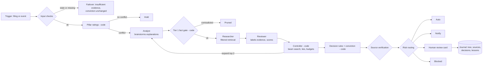

# Stock Opportunity Forecaster

A multi-agent system that reviews stock investment theses when new filings, earnings or policy changes
arrive, and recommends **hold, trim, add or exit** with cited evidence. Three model-based agents
(Researcher, Analyst, Reviewer) explore competing explanations with Tree-of-Thoughts search; plain code
enforces risk limits, routes decisions by risk, and sends high-impact or uncertain cases to a human.

Capstone project for the Agentic AI program (Building Autonomous Systems for Real-World Applications).

> **Research and education only. Not financial advice. Paper trading only.** Evaluation scenarios use
> synthetic companies (tickers prefixed `SYN-`); live mode uses only free public data (SEC EDGAR, Federal
> Register, daily prices).

## The problem

A self-directed investor tracking a handful of long-term positions faces a recurring, high-stakes
question: *new information just arrived. Does my original reason for owning this still hold?*
A company's press release, its 10-Q, the price chart and a policy proposal often point in different
directions. Two common failures:

- **Premature commitment:** accepting the first plausible story, usually the company's own.
- **Confident errors:** a language model alone answers fluently from stale knowledge, invents facts, gets
  arithmetic wrong, and grades its own reasoning.

## Architecture



| Component | Type | Role |
| --- | --- | --- |
| Researcher | Agent | Turns questions into filtered retrieval calls; returns passages with source, tier and date |
| Analyst | Agent | Proposes and refines competing explanations; never scores them |
| Reviewer | Agent (different, stronger model) | Labels evidence, scores branches, raises evidence-based challenges |
| Controller | Code | Tree-of-Thoughts beam search (width 2, depth 2), pruning, ties, budgets, failover |
| Rules and guardrails | Code | Conviction table, hard risk caps, injection defense, source verification, routing |
| Retrieval | Code | Section-aware chunking, metadata filters before similarity, hybrid TF-IDF scoring, threshold |
| Journal | SQLite | Long-term memory: review trees, human decisions with reason codes, shadow positions, lessons |
| Scanner | Code | Daily breakout scan with entry, stop, target and size; every new position needs approval |

Key decisions (with the checkpoint where each was made):

- **Code decides, models judge text (1.1, 2.1).** Numbers come from structured data and a calculator;
  conviction and routing are deterministic rules.
- **Retrieval only for long text (3).** Exact figures come from SEC XBRL; filing prose goes through
  retrieval, with ticker and date filters applied *before* similarity search.
- **Tree of Thoughts only at judgment points (4).** Prune on contradiction, not on missing evidence;
  keep two branches alive at depth 1.
- **Three agents, not more (5).** Generation and evaluation are separated so the Analyst never grades
  itself. Shared state has a strict contract; a record missing its source or date is rejected.
- **Decide on the action, not on which story is true (5 feedback).** When two explanations stay tied,
  take an action acceptable under both, or hold briefly with a tighter stop until a dated event settles it.
- **Risk-based routing instead of approving everything (6).** Low-risk results run automatically; new
  positions, exits, large trims, contested reviews, low reviewer confidence and market shocks go to a human.

## Results

Offline evaluation (`python -m eval.run_eval`, synthetic inputs, scripted model responses; this tests the
control layer and retrieval, not model judgment). Full table: [`eval/results/offline_results.md`](eval/results/offline_results.md).

| Measure | Result |
| --- | --- |
| Scenarios passing all expectations (reasoning, decision, control, fallback, safety) | 18/18 |
| Same decision with inputs shuffled (3 shuffles each) | 18/18 |
| Evidence from another company or an outdated filing used | 0 |
| Prompt injection in a retrieved article | flagged and routed to human review |
| Unsourced number in a recommendation | rewritten once, then blocked |
| Model calls per full review (average / max, budget 14) | 5.3 / 10 |
| Retrieval: correct passage ranked first, with vs without filters | 80% vs 70% |
| Retrieval: wrong-company or outdated passage ranked first, without filters | 20% (0% with filters) |

Live evaluation (`python -m eval.run_live_eval --repeats 3`, real models: Analyst `openai/gpt-4o-mini`,
Reviewer `anthropic/claude-sonnet-4.5`; 5 scenarios x 3 runs). Full table: [`eval/results/live_results.md`](eval/results/live_results.md).

| Measure | Multi-agent (ToT) | Single chain of thought |
| --- | --- | --- |
| Acceptable action and not blocked | 14/15 | 11/15 |
| Policy enacted against the thesis: exit found | 3/3 | 0/3 (trim every time) |
| Same action in all three runs | 1/5 scenarios | 5/5 scenarios |
| Median model calls and seconds per review | 5 calls, 35 s | 1 call, 3 s |

Scanner backtest from 2024 (`python -m eval.backtest_scanner`): 135 trades, +0.11 R per trade, maximum
drawdown 8.8%, but an average trade return of 0.45% against 0.46% for SPY over the same days: no edge
over the index before costs. Details: [`eval/results/backtest_results.md`](eval/results/backtest_results.md).

A worked example with the full reasoning tree and the reviewer card: [`eval/results/demo_S01.md`](eval/results/demo_S01.md).

## Setup

```bash
git clone https://github.com/kotimaddala/stock-forecaster.git
cd stock-forecaster
python -m venv .venv && source .venv/bin/activate      # Windows: .venv\Scripts\activate
pip install -r requirements.txt
python -m pytest -q                                     # 58 tests, no network needed
```

For live mode, copy `.env.example` to `.env` and set:

| Variable | Needed for |
| --- | --- |
| `OPENROUTER_API_KEY` | Live model calls (Analyst, Reviewer, Researcher) |
| `SEC_USER_AGENT` | SEC EDGAR access (your name and email, required by the SEC) |
| `ANALYST_MODEL`, `REVIEWER_MODEL` | Optional model choices; the Reviewer should be the stronger model |
| `ALPACA_API_KEY`, `ALPACA_SECRET_KEY` | Optional paper trading; otherwise orders go to a dry-run log |

Or open [`notebooks/colab_quickstart.ipynb`](notebooks/colab_quickstart.ipynb) in Google Colab.

## Usage

```bash
python -m forecaster.cli demo                                   # offline walkthrough, no keys
python -m eval.run_eval                                         # offline evaluation -> eval/results/
python -m forecaster.cli review examples/thesis_example.json --trigger "10-Q filed"
python -m forecaster.cli review examples/thesis_example.json --mode single   # baseline
python -m forecaster.cli scan --tickers AAPL MSFT NVDA ETN PWR
python -m forecaster.cli decide 1 approve agree                 # record your decision
python -m forecaster.cli monitor                                # routes, escalation, approvals, lessons
python -m eval.run_live_eval --repeats 3                        # ToT vs single chain, real models
python -m eval.backtest_scanner --start 2024-01-01              # point-in-time scanner backtest
```

### As a Claude Code plugin (MCP)

`forecaster/mcp_server.py` exposes read-only tools (`review_thesis`, `scan_breakouts`, `journal_summary`,
`offline_demo`) over the Model Context Protocol. There is deliberately no trading tool.

```
/plugin marketplace add kotimaddala/stock-forecaster
```

## Repository map

```text
forecaster/
  agents.py          Researcher, Analyst, Reviewer (prompts, JSON contracts)
  controller.py      Tree-of-Thoughts search, decision rules, failover, routing
  retrieval.py       Filtered hybrid retrieval with threshold and logs
  guardrails.py      Input checks, injection defense, source verification, trade caps
  risk.py            Pillars, conviction table, upgrade rule, risk routing
  models.py          Shared-state contract (Fact, Chunk, Evidence, Branch, Recommendation)
  journal.py         SQLite memory: reviews, decisions, shadow positions, lessons
  scanner.py         Daily breakout scan (sequential pipeline)
  pipeline.py        Live inputs from SEC EDGAR, Federal Register and prices
  data/              Cached HTTP clients for each public source
  llm.py             OpenRouter client (plain HTTP) and scripted client for offline runs
  broker.py          Approval-gated paper orders (dry-run or Alpaca paper)
  graph_langgraph.py Optional LangGraph version of the coordination graph
  mcp_server.py      MCP server for Claude Code / Gemini CLI
eval/
  scenario_data.py   18 synthetic scenarios + retrieval questions
  run_eval.py        Offline evaluation;  run_live_eval.py  live ToT vs CoT
  backtest_scanner.py  Point-in-time backtest vs SPY
  results/           Generated results and the worked demo
  scenarios/         Each scenario as JSON (inputs, expected outcome)
tests/               58 tests: rules, guardrails, retrieval, parsing, pipeline, scenarios
notebooks/           Colab quickstart
```

## Limitations

- Offline results test the control logic with scripted model outputs. In the live evaluation the
  multi-agent review's action varied between runs (hold vs trim) in four of five scenarios.
- Retrieval uses TF-IDF, which misses paraphrases (e.g. "supplier concentration" vs "limited number of
  suppliers"); an embedding model is the natural upgrade behind the same interface.
- Policy direction (favorable or unfavorable) is recorded by the thesis owner, not inferred.
- Free price data can be delayed; costs, slippage and taxes are not modeled in the backtest.
- Markets are noisy: even good decisions lose sometimes, so outcome metrics need many cases.

## License

MIT. See [LICENSE](LICENSE).
